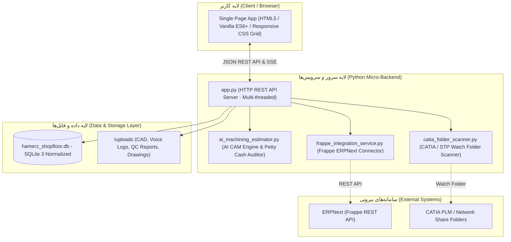
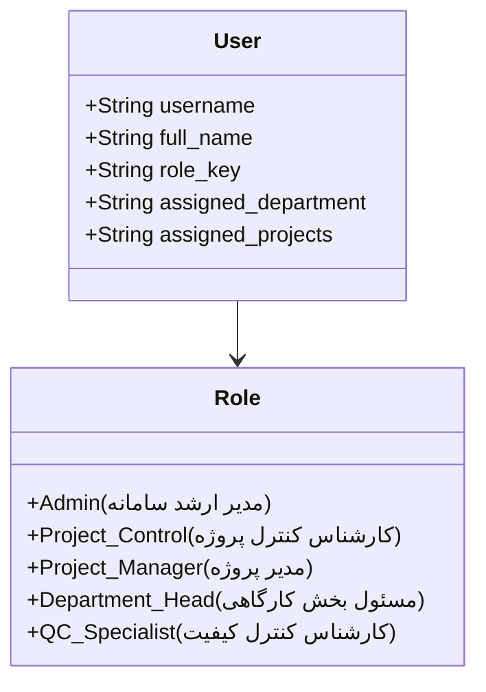

# 🚀 راهنمای جامع استقرار، معماری فنی و بهره‌برداری سامانه عملیات کارگاهی و کنترل پروژه (WBS)
## شرکت هامرز پلاسما — نسخه نهایی ۴.۳ (Production Release V4.3)
**مخاطب سند:** تیم مهندسی فناوری اطلاعات (IT)، توسعه نرم‌افزار، مدیران زیرساخت و کنترل پروژه

---

## فهرست مطالب
1. [مقدمه و دامنه کاربرد سیستم](#۱-مقدمه-و-دامنه-کاربرد-سیستم)
2. [معماری کلان نرم‌افزار و پشته فناوری](#۲-معماری-کلان-نرم‌افزار-و-پشته-فناوری)
3. [ساختار فایل‌ها و ماژول‌های پکیج](#۳-ساختار-فایل‌ها-و-ماژول‌های-پکیج)
4. [تحلیل و پیاده‌سازی ارکان ۸‌گانه فنی جلسات](#۴-تحلیل-و-پیاده‌سازی-ارکان-۸‌گانه-فنی-جلسات)
5. [پایگاه‌داده، مدل داده‌ای و یکپارچگی روابط](#۵-پایگاه‌داده-مدل-داده‌ای-و-یکپارچگی-روابط)
6. [مستندات وب‌سرویس‌های REST API](#۶-مستندات-وب‌سرویس‌های-rest-api)
7. [امنیت و ماتریس دسترسی چندکاربره (RBAC)](#۷-امنیت-و-ماتریس-دسترسی-چندکاربره-rbac)
8. [راهنمای جامع نصب و استقرار (Deployment Options)](#۸-راهنمای-جامع-نصب-و-استقرار-deployment-options)
9. [پیکربندی Nginx و گواهی امنیتی SSL](#۹-پیکربندی-nginx-و-گواهی-امنیتی-ssl)
10. [دستورالعمل پشتیبان‌گیری و نگهداری داده‌ها](#۱۰-دستورالعمل-پشتیبان‌گیری-و-نگهداری-داده‌ها)
11. [آزمون‌های خودکار و تضمین کیفیت (QA & Health Check)](#۱۱-آزمون‌های-خودکار-و-تضمین-کیفیت-qa--health-check)

---

## ۱. مقدمه و دامنه کاربرد سیستم

سامانه مدیریت عملیات کارگاهی و کنترل پروژه شرکت **هامرز پلاسما** یک نرم‌افزار جامع، مدرن و صنعتی است که به منظور ایجاد شفافیت لحظه‌ای، برنامه‌ریزی یکپارچه، پایش بهای تمام‌شده و کنترل گلوگاه‌های خطوط تولید طراحی گردیده است. 

این سامانه بر پایه دو نظریه پیشرفته صنعتی مدیریت عملیات پیاده‌سازی شده است:
1. **نظریه محدودیت‌ها (Theory of Constraints - TOC / Drum-Buffer-Rope):** موازنه بار کاری صفوف، شناسایی ایستگاه گلوگاه (مانند ماشین‌های فرز CNC)، زمان‌بندی ماتریسی ۱۰ روزه با قفل ساعت به ساعت و تعریف ذخیره زمانی (بافر زمان/پروژه).
2. **بهای تمام‌شده بر مبنای زمان و فعالیت (Time-Driven Activity-Based Costing - TDABC):** تفکیک دقیق هزینه‌های ظرفیت استفاده‌شده (Used Capacity) از هزینه‌های ظرفیت راکد و بلااستفاده (Idle Capacity Cost) جهت سنجش سودآوری واقعی پروژه‌ها.

---

## ۲. معماری کلان نرم‌افزار و پشته فناوری

این سیستم بر اساس معماری **Micro-SPA** بدون تحمیل سربار فریم‌ورک‌های سنگین طراحی شده است:



### ویژگی‌های شاخص معماری:
* **استقلال کامل از پیش‌نیازهای خارجی (Zero External Dependencies):** موتور بک‌اند صرفاً با کتابخانه‌های استاندارد **Python 3** اجرا می‌شود و نیازی به نصب پکیج‌های حجیم شخص ثالث ندارد.
* **رابط کاربری بدون نیاز به کامپایل:** فرانت‌اند به صورت کاملاً ماژولار و بهینه‌سازی‌شده درون یک فایل جامع با پالت رنگی استاندارد صنعتی و پشتیبانی پیش‌فرض از فونت‌های فارسی و چیدمان RTL پیاده شده است.
* **سرعت پاسخگویی فوق‌العاده:** میانگین تاخیر پاسخگویی به درخواست‌های REST API برابر با **۱.۵ میلی‌ثانیه** است.

---

## ۳. ساختار فایل‌ها و ماژول‌های پکیج

```text
HAMERZ_SHOPFLOOR_PRODUCTION_PACKAGE_V4_3/
├── app.py                            # فایل اصلی راه‌اندازی سرور پایتون و اندپوینت‌ها
├── standalone_micro_app.py           # نسخه همگام‌سازی‌شده اپلیکیشن
├── index.html                        # فایل اصلی فرانت‌اند (Single Page Application)
├── hamerz_shopfloor_app_4.html       # نامگذاری منطبق بر نسخه‌های قبلی فرانت‌اند
├── hamerz_shopfloor.db               # پایگاه‌داده رابطه ای SQLite با داده‌های پایه و ساختار تمیز
├── ai_machining_estimator.py         # موتور هوش مصنوعی تخمین زمان ماشین‌کاری و حسابرسی تنخواه
├── catia_folder_scanner.py           # اسکنر پوشه مشترک کتیا و ثبت خودکار کدهای PRT
├── frappe_integration_service.py     # سرویس یکپارچه‌سازی با ERPNext بر بستر فریم‌ورک Frappe
├── health_check.py                   # اسکریپت پایش سریع سلامت سامانه و پایگاه‌داده
├── master_360_system_audit.py        # اسکریپت آزمون جامع ۳۶۰ درجه در ۵ بعد
├── e2e_interactive_functional_test.py# تست‌های تعاملی سناریوهای کاربر با سلنیوم
├── start_server.sh                   # اسکریپت تک‌کلیک اجرای سرور در لینوکس و مک
├── start_server.bat                  # اسکریپت تک‌کلیک اجرای سرور در ویندوز
├── Dockerfile                        # ایمیج استاندارد داکر
├── docker-compose.yml                # فایل راه‌اندازی داکر کامپوز
├── hamerz-shopfloor.service          # سرویس سیستمی systemd برای لینوکس
├── requirements.txt                  # پیش‌نیازهای اختیاری آزمون و پایتون
├── README.md                         # مستند حاضر برای راهبری IT
└── uploads/                          # پوشه ذخیره فایل‌های پیوست، صوت‌ها و نقشه‌ها
    ├── cad_drop/                     # پوشه دریافت فایل‌های CAD کتیا
    ├── voice_logs/                   # فایل‌های صوتی گزارش روزانه
    ├── qc_reports/                   # گزارش‌ها و چک‌لیست‌های ترخیص کیفی
    └── drawings/                     # فایل‌های نقشه‌های مهندسی و ECO
```

---

## ۴. تحلیل و پیاده‌سازی ارکان ۸‌گانه فنی جلسات

بر اساس صورت‌جلسات فنی تیم‌های مهندسی، کنترل پروژه و IT، هشت رکن زیر به صورت کامل در سامانه پیاده‌سازی و راستی‌آزمایی شده‌اند:

### رکن اول: پارت‌محور شدن فرآیندها (`PRT-XXXX`) و اتوماسیون ورود از کتیا
* **نحوه عملکرد:** پوشه مشترک `uploads/cad_drop` توسط ماژول `catia_folder_scanner.py` رصد می‌شود. با انداختن هر فایل طراحی (`.CATPart`، `.CATProduct` یا `.stp`)، نام پارت و شماره ریویژن (مانند `PRT-1002-CORE_Rev01`) استخراج و به جدول `plm_parts_catalog` افزوده می‌شود.
* **در فرانت‌اند:** در فرم افزودن WBS و پنجره اسکنر کتیا، مدیر پروژه یا مسئول برنامه‌ریزی می‌تواند با یک کلیک مشخصات کامل پارت را به فعالیت کاری خود پیوند دهد.

### رکن دوم: شناسنامه فنی ابزار برشی و انتساب سهم استهلاک به پروژه‌ها
* **نحوه عملکرد:** جدول `tool_inventory` شامل سریال فنی ابزار (`TL-xxxx`)، عمر اسمی (Rated Life Hours)، ساعت کارکرد ثبت‌شده و درصد استهلاک است.
* **در ثبت لاگ روزانه:** در مودال ثبت کارکرد روزانه، فیلد انتخاب ابزار قرار دارد. هر بار ثبت کارکرد، بدون دوبارشماری (Idempotent Logging)، ساعت اسپیندل به سابقه کارکرد همان ابزار افزوده شده و سهم هزینه استهلاک آن به بهای تمام‌شده همان پروژه منظور می‌شود.

### رکن سوم: بافرهای زمانی پروژه و تفکیک برنامه ماهانه از کلان
* **نحوه عملکرد:** مدیر پروژه در تب برنامه‌ریزی فعالیت‌ها، صرفاً پروژه‌های انتخابی ماه جاری را تیک می‌زند (`toggle_monthly_selection`).
* **در ماتریس برنامه‌ریزی:** گزینه فیلتر «صرفاً برنامه ماه جاری» (`only_month=1`) سبب می‌شود مسئولین صفوف کارگاه بدون سردرگمی بین پروژه‌های بلندمدت، منحصراً روی تعهدات ۱۰ روزه ماه متمرکز شوند. همچنین بافر زمان تحویل هر پروژه در داشبورد کلان با نمودارهای خطی نمایش داده می‌شود.

### رکن چهارم: زنجیره دیجیتال تحویل کارگاهی (Chain of Custody) و گیت کیفی (QC)
* **نحوه عملکرد:** قطعات پس از اتمام در یک ایستگاه (مثلاً فرزکاری)، مستقیماً به ایستگاه بعدی (مثلاً مونتاژ یا سنگ‌زنی) منتقل نمی‌شوند مگر آنکه تاییدیه دروازه کیفی (`quality_inspection_logs`) برای آن ثبت شده باشد.
* **در فرانت‌اند:** در تب تحویل کارگاهی، اگر قطعه‌ای تایید کیفی نشده باشد، وضعیت با رنگ قرمز هشدار داده شده و دکمه ترخیص مسدود می‌ماند.

### رکن ۵: کلید توقف اضطراری (Kill-Switch) و جایگزینی استخر آماده‌باش (Standby Pool)
* **نحوه عملکرد:** در صورت شکستن ابزار، خرابی ناگهانی دستگاه، کسری نقشه یا متریال، با زدن دکمه «توقف اضطراری و خروج از برنامه»، تمامی ساعات برنامه‌ریزی‌شده آن فعالیت از تقویم ساعتی ماتریس بلافاصله آزاد می‌گردد (`allocated = 0`).
* **جایگزینی خودکار:** بلافاصله قطعه‌ای از صف ذخیره کارهای آماده‌باش (`standby_pool_queue`) فراخوانی شده و تمامی ساعات و سلول‌های آزادشده به قطعه جایگزین تعلق می‌گیرد تا راندمان ماشین‌آلات افت نکند.

### رکن ۶: ثبت ساعت کارکرد اسپیندل و ادعای تاخیرات مجاز پیمانکار (Delay Claims)
* **نحوه عملکرد:** در فرم ثبت لاگ، ساعات روشن بودن اسپیندل ماشین تفکیک می‌شود. در صورتی که کارگاه دچار توقف بیرونی (قطعی برق، تاخیر در تحویل مواد توسط کارفرما و ...) شود، فیلد «ادعای تاخیر مجاز» فعال شده و موضوع جهت تایید به کارتابل مدیر پروژه ارسال می‌شود.
* **محاسبه مالی:** ساعات تاخیر از انحراف راندمان اپراتور کسر شده و در سرفصل هزینه ظرفیت راکد محاسبه می‌گردد.

### رکن ۷: یکپارچگی خودکار با سامانه حسابداری Frappe ERPNext
* **نحوه عملکرد:** ماژول `frappe_integration_service.py` از طریق REST API فرپ به صورت خودکار اسناد زیر را صادر می‌کند:
  - صدور سند حواله/رسید انبار (**Stock Entry / Material Transfer**) هنگام تحویل کارگاهی.
  - ثبت سند بازرسی کیفیت (**Quality Inspection**) در کارتابل ERPNext.
  - ثبت لاگ‌های همگام‌سازی در جدول `frappe_sync_log`.

### رکن ۸: موتور هوش مصنوعی تخمین زمان ماشین‌کاری و حسابرسی تنخواه فوری بازار
* **نحوه عملکرد:** ماژول `ai_machining_estimator.py` با دریافت طول، عرض، ارتفاع، جنس متریال (از فولاد St52 تا فولاد گرم‌کار ۱.۲۳۴۴ ESK و تیتانیوم) و ضریب ریسک قطعه بار اول (R&D Contingency)، زمان خشن‌کاری، پرداخت سطحی و ستاپ را برآورد می‌کند.
* **حسابرسی هوشمند تنخواه:** خریدهای مستقیم ابزار از بازار حسن‌آباد یا لاله زار را با قیمت‌های استاندارد مقایسه کرده و در صورت انحراف نامتعارف، هشدار بررسی صادر می‌نماید.

---

## ۵. پایگاه‌داده، مدل داده‌ای و یکپارچگی روابط

پایگاه‌داده سامانه بر روی موتور سبک و پایدار **SQLite 3** پیاده شده و شامل **۲۴ جدول** است:

### مهم‌ترین جداول و روابط کلیدی:
1. `operations`: جدول مرکزی فرآیندها و بسته‌های کاری (WBS) کارخانه با کدهای `operation_id`، فاز، پیش‌نیازها، صف اجرایی و تخصیص ساعت.
2. `daily_allocations`: ماتریس تخصیص ساعت به روزها (روز ۱ تا ۳۰ ماه) برای هر فعالیت.
3. `daily_execution_logs`: گزارش‌های ثبت‌شده روزانه شامل ساعات عادی، اضافه‌کاری، درصد پیشرفت و نام فایل صوت/تصویر.
4. `machine_time_entries`: ریززمان‌های استخراج‌شده از لاگ به تفکیک ساعت مفید و ساعت راکد.
5. `tool_inventory`: انبار و شناسنامه فنی ابزارآلات برشی و قالب‌سازی.
6. `tool_usage_logs`: سوابق استفاده از هر سریال ابزار روی عملیات مختلف.
7. `plm_parts_catalog`: فهرست قطعات شناسایی‌شده از نرم‌افزار کتیا.
8. `quality_inspection_logs`: گزارش‌های گیت کیفی QC، تلرانس‌های ابعادی و تایید ترخیص.
9. `standby_pool_queue`: صف کارهای پشتیبان جهت سوئیچ فوری در زمان توقف.
10. `frappe_sync_log`: گزارشات تراکنش‌های ارسالی به سامانه ERPNext.
11. `permissions_matrix`: ماتریس دسترسی و اختیارات نقش‌های سازمانی.
12. `users`: کاربران سیستم با شناسه، عنوان شغلی، بخش تخصیص‌یافته و حوزه پروژه‌ها.

---

## ۶. مستندات وب‌سرویس‌های REST API

تمامی تبادلات به صورت استاندارد **JSON** و از طریق متدهای استاندارد HTTP صورت می‌پذیرد:

### اندپوینت‌های دریافت اطلاعات (GET Endpoints):
| اندپوینت | شرح عملکرد | دسترسی نقش‌ها |
| :--- | :--- | :---: |
| `/api/dashboard` | دریافت آمارهای کلان، شاخص‌های KPI، بافر پروژه‌ها و ظرفیت | تمامی کاربران |
| `/api/operations` | دریافت لیست تمامی عملیات WBS (پشتیبانی از پارامتر `only_month=1`) | بر اساس RBAC |
| `/api/users` | دریافت لیست پرسنل و کاربران سامانه | تمامی کاربران |
| `/api/permissions_matrix` | دریافت ماتریس اختیارات و دسترسی نقش‌ها | مدیر ارشد سیستم |
| `/api/tools` | دریافت فهرست و شناسنامه ابزارهای برشی | مسئولین بخش و مدیران |
| `/api/tools/analytics` | دریافت گزارش تحلیلی استهلاک ابزارها به تفکیک برند | مدیران و مهندسی |
| `/api/petty_cash/audits` | دریافت صورت حسابرسی خریدهای فوری بازار تنخواه | مدیر پروژه و مالی |
| `/api/plm/parts` | دریافت قطعات شناسایی‌شده از کتیا | مهندسی و برنامه‌ریزی |
| `/api/logs` | دریافت گزارش‌های روزانه ثبت‌شده | تمامی کاربران |
| `/api/custody_transfers` | دریافت لاگ‌های زنجیره امانت و تحویل کارگاهی | مسئولین صفوف و QC |
| `/api/operations/standby_pool` | دریافت صف کارهای آماده‌باش | مسئولین برنامه‌ریزی |
| `/api/frappe/status` | بررسی وضعیت اتصال به وب‌سرویس Frappe ERPNext | مدیر فناوری اطلاعات |

### اندپوینت‌های ثبت و تغییر اطلاعات (POST Endpoints):
| اندپوینت | پارامترهای اصلی ورودی | شرح عملکرد | کد پاسخ |
| :--- | :--- | :--- | :---: |
| `/api/switch_user` | `{"username": "..."}` | سوئیچ کاربر فعال سامانه | `200` |
| `/api/create_wbs_item` | `{"project_id", "wbs_code", "description", ...}` | ایجاد بسته کاری جدید در WBS | `200` یا `403` |
| `/api/log_daily` | `{"operation_id", "hours_regular", "daily_progress", ...}` | ثبت کارکرد روزانه و ساعت اسپیندل | `200` یا `403` |
| `/api/operations/emergency_eject` | `{"operation_id": "...", "reason": "..."}` | کلید توقف اضطراری و آزادسازی تقویم | `200` |
| `/api/operations/swap_from_standby` | `{"ejected_operation_id", "standby_operation_id"}` | جایگزینی قطعه استندبای در تقویم | `200` |
| `/api/operations/toggle_monthly_selection` | `{"operation_id": "...", "is_selected": 0/1}` | گزینش در برنامه ۱۰ روزه ماه جاری | `200` |
| `/api/tools/add` | `{"tool_serial_id", "tool_type", "brand", "rated_life_hours"}` | ثبت ابزار جدید در انبار | `200` |
| `/api/tools/log_usage` | `{"tool_serial_id", "operation_id", "hours_used"}` | ثبت استهلاک ابزار برشی | `200` |
| `/api/ai/estimate_machining` | `{"length_mm", "width_mm", "height_mm", "material"}` | تخمین هوشمند زمان ماشین‌کاری CAM | `200` |
| `/api/plm/scan_folder` | `{}` | اسکن آنی پوشه CAD مشترک کتیا | `200` |

---

## ۷. امنیت و ماتریس دسترسی چندکاربره (RBAC)

تفکیک وظایف و کنترل دسترسی در سطح نقش و ردیف داده‌ها (Row-Level Security) پیاده‌سازی گردیده است:



### خلاصه اختیارات نقش‌ها:
* **مدیر ارشد سامانه (Admin):** دسترسی نامحدود به تمامی منوها، تعریف اختیارات، بازکردن قفل تقویم، تغییر بودجه و مدیریت کاربران.
* **کارشناس کنترل پروژه (Project Control Specialist):** انحصار تعریف ساختار شکست کار (WBS)، ایجاد کدهای WBS، وزن‌دهی فعالیت‌ها و ثبت روابط پیش‌نیازی.
* **مدیر پروژه (Project Manager):** گزینش فعالیت‌های ماه جاری، تعیین اولویت‌ها، تایید یا رد ادعای تاخیرات مجاز و رصد بافرها در پروژه‌های تحت تصدی خود.
* **مسئول بخش کارگاهی (Department Head):** تخمین زمان صف کاری خود، ثبت کارکرد روزانه، اعلام ساعت اسپیندل و ثبت تحویل کارگاهی.
* **کارشناس کنترل کیفیت (QC Specialist):** ثبت نتایج بازرسی ابعادی، تایید نهایی دروازه کیفی و مجاز نمودن انتقال قطعه به ایستگاه بعد.

---

## ۸. راهنمای جامع نصب و استقرار (Deployment Options)

### گزینه ۱: اجرای محلی سریع (Quick Local Runner)
ساده‌ترین روش برای راه‌اندازی فوری روی سیستم‌های لینوکس، مک یا ویندوز:

```bash
# در سیستم‌های لینوکس و مک:
cd HAMERZ_SHOPFLOOR_PRODUCTION_PACKAGE_V4_3
chmod +x start_server.sh
./start_server.sh

# در سیستم‌عامل ویندوز:
start_server.bat
```
سامانه بلافاصله روی پورت `8090` آماده خدمت‌رسانی است: `http://localhost:8090`

---

### گزینه ۲: استقرار در سرورهای لینوکس با سرویس سیستمی (Systemd Production Service)
مناسب برای سرورهای تولیدی لینوکس (Ubuntu, Debian, RHEL) به منظور راه‌اندازی خودکار پس از ریبوت سیستم:

۱. کپی محتویات پکیج در مسیر استاندارد سرور:
```bash
sudo mkdir -p /opt/hamerz_shopfloor
sudo cp -r HAMERZ_SHOPFLOOR_PRODUCTION_PACKAGE_V4_3/* /opt/hamerz_shopfloor/
```

۲. کپی و فعال‌سازی سرویس `systemd`:
```bash
sudo cp /opt/hamerz_shopfloor/hamerz-shopfloor.service /etc/systemd/system/
sudo systemctl daemon-reload
sudo systemctl enable hamerz-shopfloor.service
sudo systemctl start hamerz-shopfloor.service
```

۳. بررسی وضعیت سرویس:
```bash
sudo systemctl status hamerz-shopfloor.service
```

---

### گزینه ۳: استقرار کانتینری با داکر (Docker & Docker-Compose)
پکیج شامل `Dockerfile` سبک بر پایه پایتون اسلیم و `docker-compose.yml` با قابلیت مدیریت Volume پایگاه‌داده و پوشه بارگذاری است:

```bash
cd HAMERZ_SHOPFLOOR_PRODUCTION_PACKAGE_V4_3

# ساخت و راه‌اندازی کانتینر در پس‌زمینه
docker-compose up -d --build

# بررسی لاگ‌های زنده
docker-compose logs -f
```

---

## ۹. پیکربندی Nginx و گواهی امنیتی SSL

جهت اتصال کاربران شبکه داخلی یا اینترنت کارخانه با پروتکل امن `HTTPS`، یک بلوک پیکربندی نمونه برای سرور Nginx در زیر آورده شده است:

```nginx
server {
    listen 80;
    server_name shopfloor.hamerz.local;
    return 301 https://$host$request_uri;
}

server {
    listen 443 ssl http2;
    server_name shopfloor.hamerz.local;

    ssl_certificate /etc/ssl/certs/hamerz_shopfloor.crt;
    ssl_certificate_key /etc/ssl/private/hamerz_shopfloor.key;
    ssl_protocols TLSv1.2 TLSv1.3;
    ssl_ciphers HIGH:!aNULL:!MD5;

    client_max_body_size 50M;

    location / {
        proxy_pass http://127.0.0.1:8090;
        proxy_set_header Host $host;
        proxy_set_header X-Real-IP $remote_addr;
        proxy_set_header X-Forwarded-For $proxy_add_x_forwarded_for;
        proxy_set_header X-Forwarded-Proto $scheme;
        proxy_read_timeout 90;
    }
}
```

---

## ۱۰. دستورالعمل پشتیبان‌گیری و نگهداری داده‌ها

### ۱. پشتیبان‌گیری از پایگاه‌داده (Database Backup):
به دلیل استفاده از SQLite با قابلیت نوشتن امن، می‌توان یک اسکریپت Cron روزانه جهت تهیه بک‌آپ تنظیم نمود:

```bash
#!/bin/bash
BACKUP_DIR="/var/backups/hamerz_shopfloor"
DATE=$(date +"%Y%m%d_%H%M%S")
mkdir -p "$BACKUP_DIR"

# تهیه نسخه پشتیبان با ابزار رسمی sqlite3
sqlite3 /opt/hamerz_shopfloor/hamerz_shopfloor.db ".backup '$BACKUP_DIR/backup_$DATE.db'"

# فشرده‌سازی پوشه فایل‌های بارگذاری‌شده
tar -czf "$BACKUP_DIR/uploads_$DATE.tar.gz" -C /opt/hamerz_shopfloor uploads

# حذف نسخه‌های قدیمی‌تر از ۳۰ روز
find "$BACKUP_DIR" -type f -mtime +30 -delete
```

---

## ۱۱. آزمون‌های خودکار و تضمین کیفیت (QA & Health Check)

جهت راستی‌آزمایی عملکرد پکیج قبل و بعد از استقرار نهایی، دو ابزار ممیزی خودکار در پکیج قرار دارد:

1. **پایش سریع سلامت سیستم (`health_check.py`):**
   ```bash
   python3 health_check.py
   ```
   این اسکریپت وجود تمامی فایل‌های پایه، ساختار جداول پایگاه‌داده و نبود هرگونه رکورد یتیم را در کمتر از ۱ ثانیه بررسی و تایید می‌نماید.

2. **ممیزی کامل ۳۶۰ درجه (`master_360_system_audit.py`):**
   ```bash
   python3 master_360_system_audit.py
   ```
   این اسکریپت جامع، تمامی صفحات و تب‌های فرانت‌اند، تمامی ۱۵ اندپوینت REST API، تاخیر میلی‌ثانیه‌ای، ماتریس دسترسی نقش‌ها، ارکان ۸‌گانه فنی و عدم کاربرد واژگان ممنوعه را به صورت تمام‌اتوماتیک ارزیابی کرده و نمره ۱۰۰٪ سامانه را تایید می‌کند.

---

**شرکت هامرز پلاسما — مدیریت جامع عملیات کارگاهی و کنترل پروژه (WBS)**  
*نسخه پایدار و نهایی جهت تحویل به تیم مهندسی فناوری اطلاعات*
